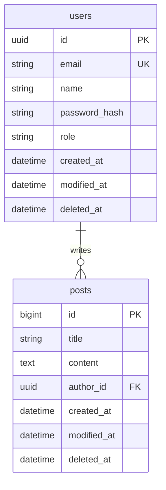
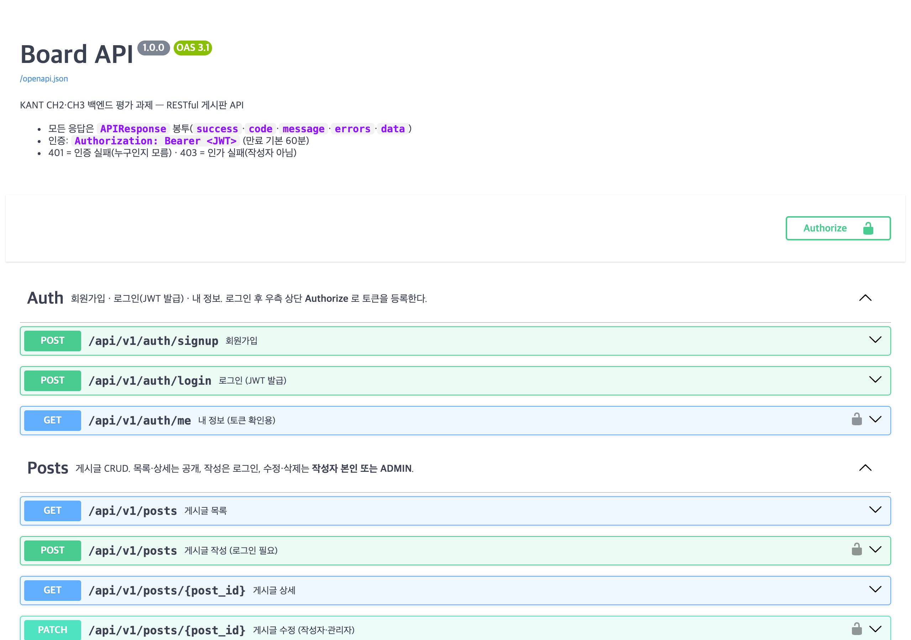
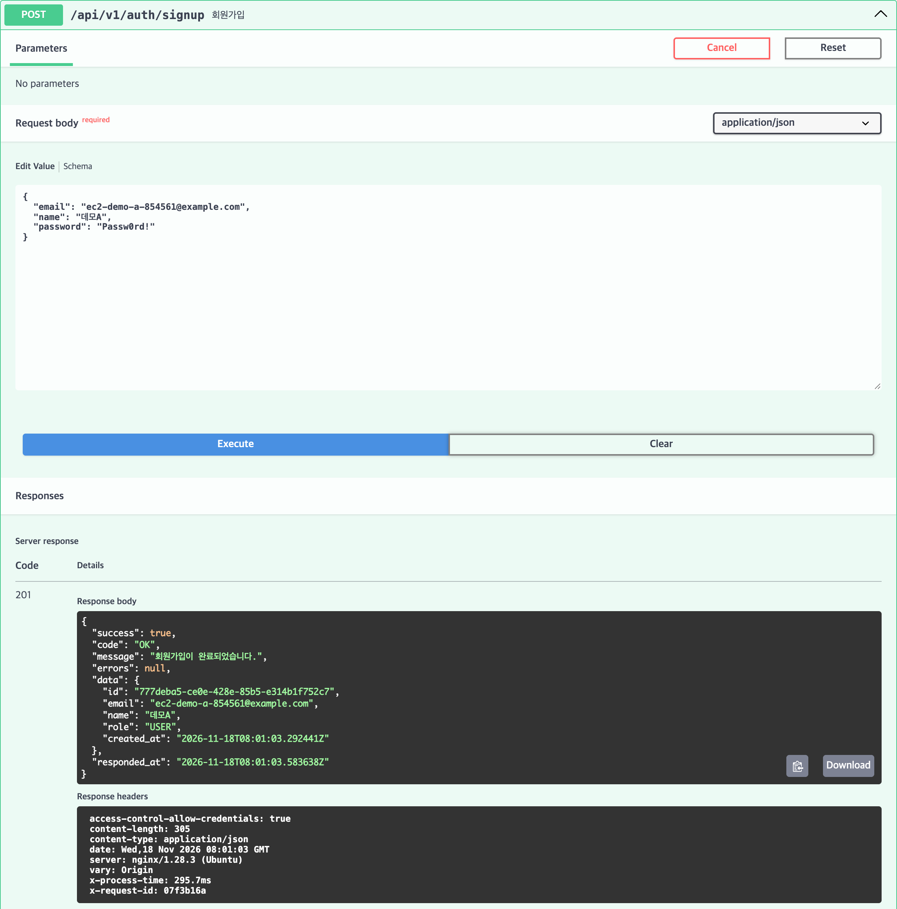
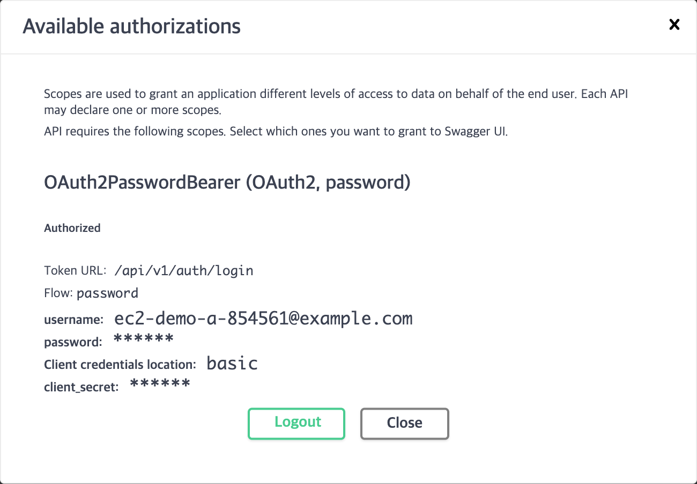
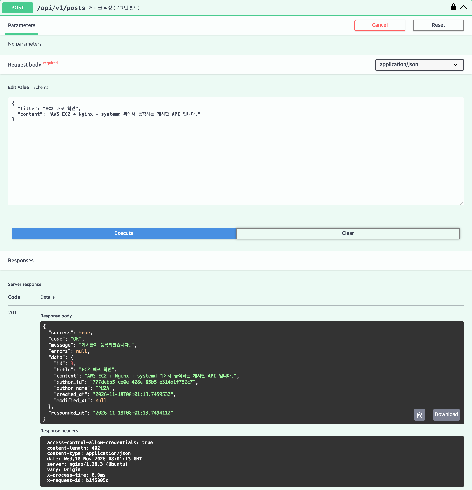
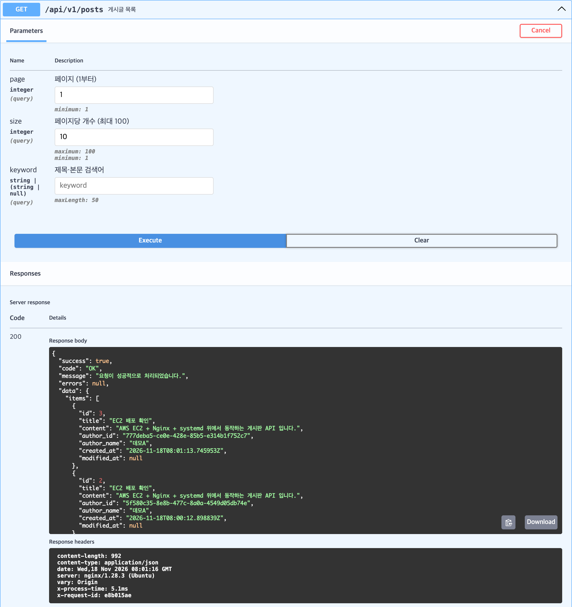
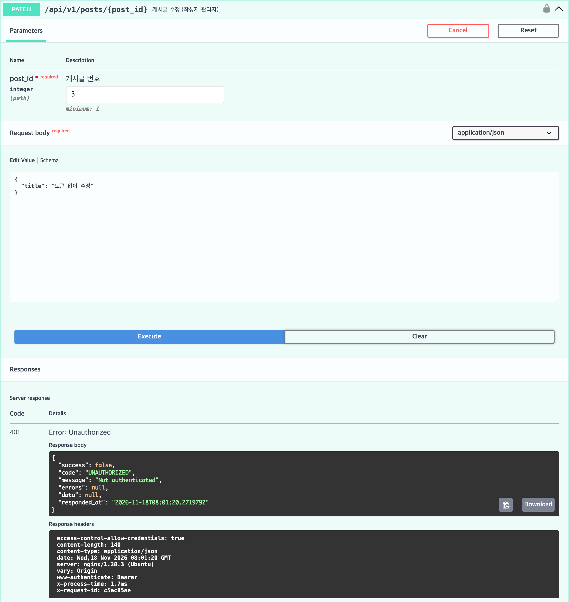
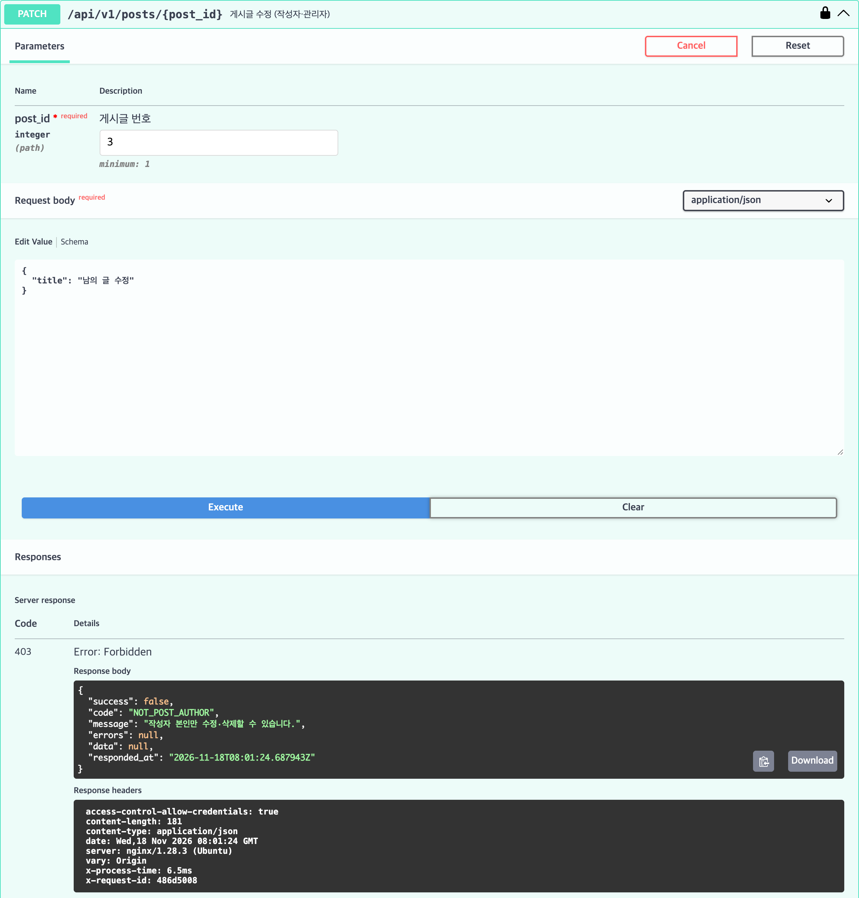
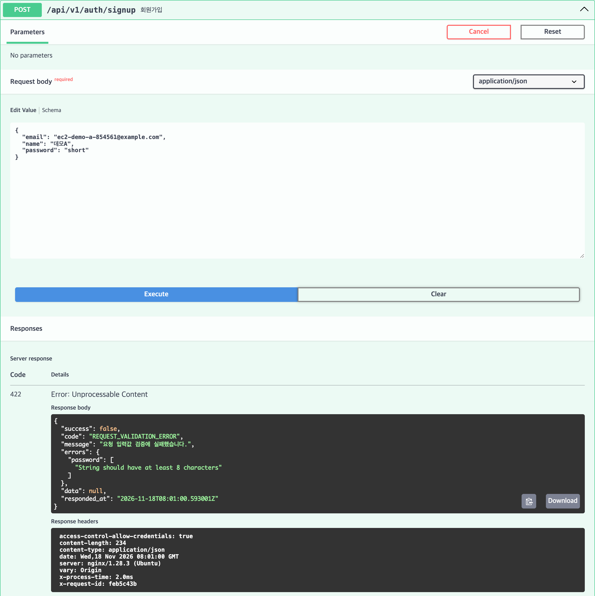

# Board API — RESTful 게시판 (FastAPI · PostgreSQL · JWT)

- **배포 주소 (AWS EC2)**: http://54.116.87.84/docs  (Swagger UI) · API 기준 경로 `http://54.116.87.84/api/v1`
- **기술**: Python 3.13 · FastAPI · SQLAlchemy 2 (async) · PostgreSQL 17 · PyJWT · bcrypt · uv · AWS EC2 · Nginx · systemd

## 아키텍처
도메인 중심 4계층 (presentation → application → domain ← infrastructure), 도메인별 `wiring/` 에서 `dependency_overrides` 로 구현체 주입.

```text
src/
├── main.py
├── shared/core/   # DB 세션 · 공통 응답 봉투 · 예외 핸들러 · 미들웨어 · 로거
├── user/          # 회원 (domain · application · infrastructure · presentation)
├── auth/          # 로그인 · JWT 발급/검증
├── board/         # 게시글 CRUD · 작성자 검증
└── wiring/        # 구현체 주입
```

## ERD


## API
| 메서드 | 경로 | 인증 | 설명 |
|---|---|---|---|
| POST | /api/v1/auth/signup | - | 회원가입 |
| POST | /api/v1/auth/login | - | 로그인 (form: username=이메일) → JWT |
| GET | /api/v1/auth/me | Bearer | 내 정보 |
| GET | /api/v1/posts | - | 목록 (page, size, keyword) |
| POST | /api/v1/posts | Bearer | 작성 |
| GET | /api/v1/posts/{id} | - | 상세 |
| PATCH | /api/v1/posts/{id} | 작성자·ADMIN | 수정 |
| DELETE | /api/v1/posts/{id} | 작성자·ADMIN | 삭제 (소프트) |

## 응답 형식
모든 응답은 `{success, code, message, errors, data, responded_at}`. 실패 시 `code` 로 분기 (예: `NOT_POST_AUTHOR`, `INVALID_TOKEN`, `REQUEST_VALIDATION_ERROR`).

## 보안
bcrypt 해시 · JWT HS512 (만료 60분, sub/jti/iat/exp 필수) · 401(인증)/403(인가) 분리 · 비밀값은 .env (저장소 미포함)

## 실행
```bash
cp .env.example .env   # JWT_SECRET_KEY 채우기: openssl rand -hex 64
docker compose up -d
uv sync
uv run uvicorn main:app --app-dir src --reload
uv run pytest -q
```

## 검증
실 PostgreSQL 17 에서 가입·로그인·CRUD·401/403/404/422·bcrypt 저장까지 확인한 기록: [docs/verification.md](docs/verification.md)

## 스크린샷
### Swagger UI


## EC2 배포 확인 (2026-11-18)
AWS EC2 (Ubuntu 24.04 · t3.micro) 위에서 **Nginx :80 → uvicorn(systemd) 127.0.0.1:8000 → PostgreSQL 17(Docker)** 로 동작한다. 아래는 배포 서버의 Swagger UI 에서 실행한 결과다 (응답 헤더 `server: nginx/1.28.3 (Ubuntu)` 가 배포 서버 응답임을 보여준다). 같은 내용을 curl 로 직접 요청한 기록: [docs/ec2-verification.md](docs/ec2-verification.md)

| # | 시나리오 | 기대 | 캡처 |
|---|---|---|---|
| 1 | `/docs` 접속 | Swagger UI · OAuth2 Authorize 버튼 |  |
| 2 | 회원가입 | 201 · `APIResponse` 봉투 |  |
| 3 | Authorize (로그인 → JWT) | Authorized |  |
| 4 | 게시글 작성 (로그인 상태) | 201 |  |
| 5 | 게시글 목록 (페이지네이션) | 200 · `page` · `total` |  |
| 6 | 토큰 없이 수정 | **401** `UNAUTHORIZED` (인증 실패) |  |
| 7 | 다른 사용자가 남의 글 수정 | **403** `NOT_POST_AUTHOR` (작성자 검증) |  |
| 8 | 짧은 비밀번호로 가입 | **422** `REQUEST_VALIDATION_ERROR` · 필드별 `errors` |  |

> 시연용 계정은 `ec2-demo-*@example.com` 형식의 테스트 계정이다.
